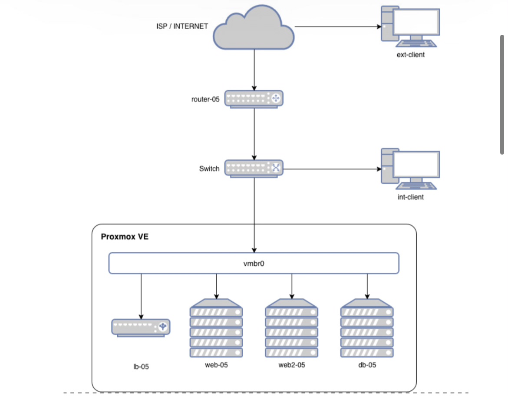

# UKK TKJ 2025/2026 - Private Cloud Proxmox + Moodle

Dokumentasi pengerjaan UKK Paket 2: membangun private cloud di Proxmox VE untuk menjalankan LMS Moodle, dengan pengembangan load balancer (2 web server).

Nomor absen: **5** (xx = 5)

## Topologi

File diagram (bisa dibuka di [app.diagrams.net](https://app.diagrams.net)) ada di folder [`topologi/`](topologi/).

## Pembagian IP

| Perangkat | Interface | IP |
|---|---|---|
| router-05 | ether1 (ke ISP) | DHCP + 172.16.100.5/24 |
| router-05 | ether2 (ke switch) | 192.168.5.1/29 + 192.168.100.1/24 |
| ext-client | ke ISP | 172.16.100.105/24 |
| int-client | ke switch | DHCP (192.168.100.10 - .50) |
| Proxmox | ke switch | 192.168.5.6/29 |
| web-05 | vmbr0 | 192.168.5.2/29 |
| db-05 | vmbr0 | 192.168.5.3/29 |
| web2-05 | vmbr0 | 192.168.5.4/29 |
| lb-05 | vmbr0 | 192.168.5.5/29 |

## Laporan

Laporan teknis versi Word (berisi semua screenshot): [`docs/Laporan_Teknis_UKK_Paket2.docx`](docs/Laporan_Teknis_UKK_Paket2.docx)

## Progres

- [x] [Konfigurasi MikroTik](docs/01-mikrotik.md)
- [ ] Proxmox dan VM
- [ ] Web server dan database
- [ ] Instalasi Moodle
- [ ] Load balancer
- [ ] Backup otomatis (cron)
- [ ] Patching, update, upgrade
