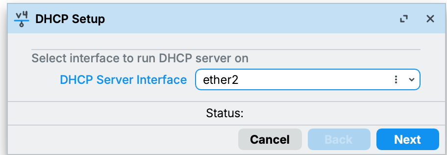
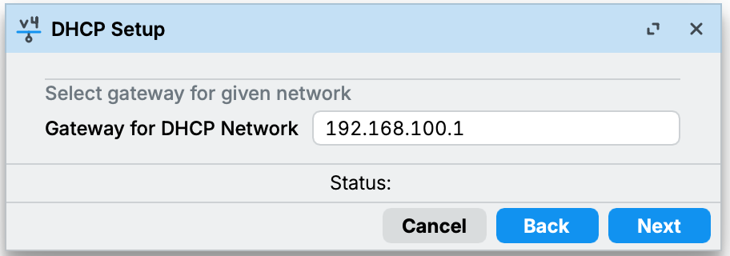
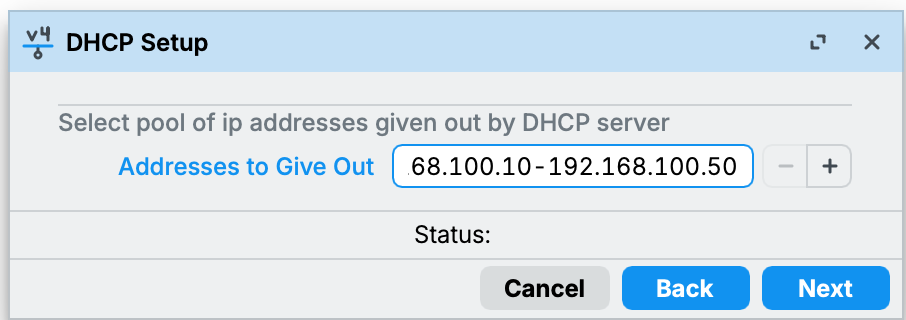
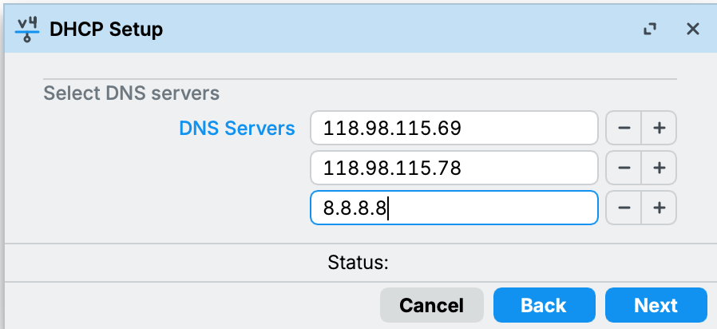
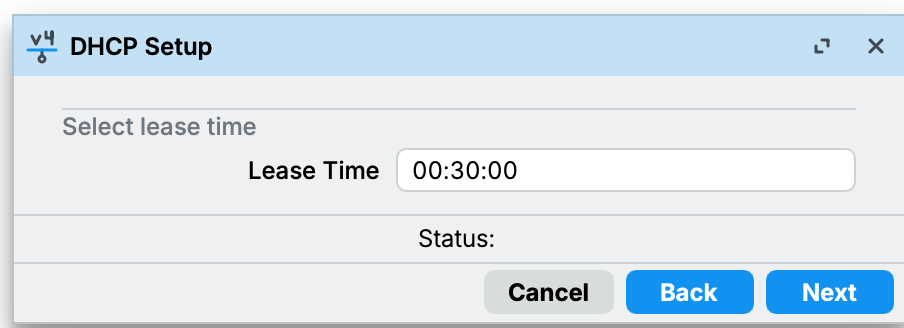
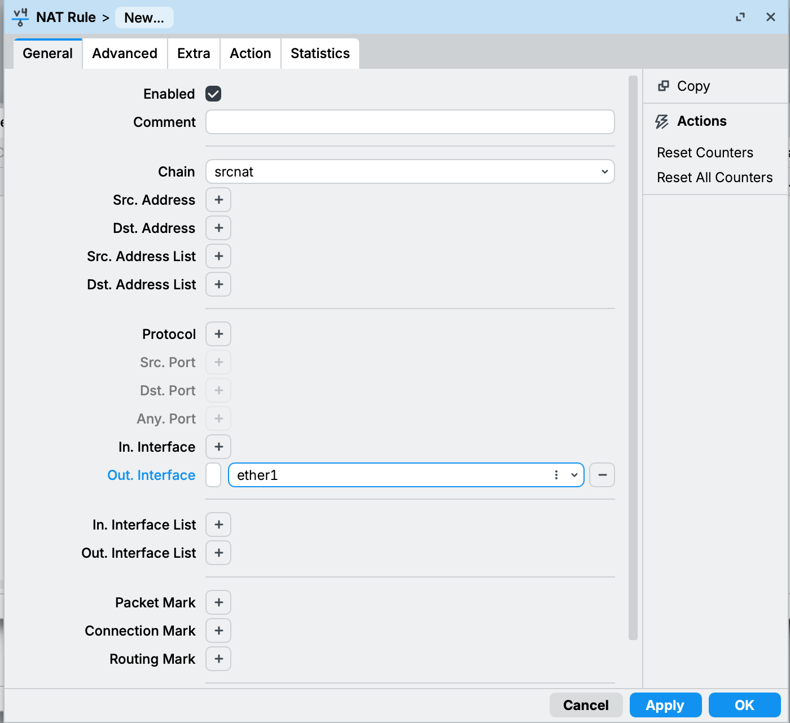
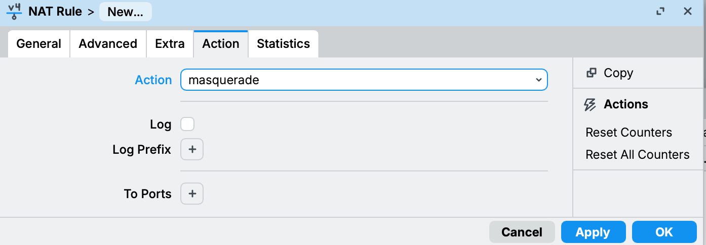
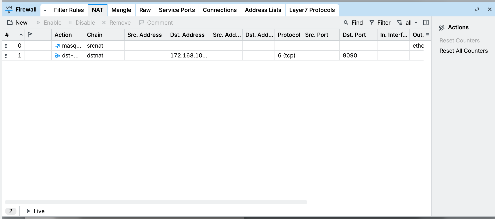

# UKK Private Cloud (Proxmox + Moodle + Load Balancer)

Dokumentasi latihan UKK TKJ paket 2: membangun private cloud di Proxmox untuk menjalankan LMS Moodle, ditambah load balancer.
Nomor absen 5, jadi semua `xx` di soal diganti `5`.

> Masih dikerjakan bertahap. Bagian yang sudah ada baru konfigurasi router MikroTik.

## Topologi

ISP → router-05 → switch → Proxmox dan int-client. ext-client ada di sisi ISP.

| Perangkat | Port / Koneksi | IP |
|---|---|---|
| router-05 | ether1 → ISP | DHCP dari ISP + `172.16.100.5/24` |
| router-05 | ether2 → switch | `192.168.5.1/29` dan `192.168.100.1/24` |
| int-client | switch | DHCP (`192.168.100.10-50`) |
| ext-client | sisi ISP | `172.16.100.105/24` |
| Proxmox | switch | `192.168.5.6/29` |
| web-05 / db-05 / web2-05 / lb-05 | vmbr0 | `.2` / `.3` / `.4` / `.5` |

## Perangkat

- MikroTik hEX, RouterOS 7.16.1
- WinBox 4
- Switch unmanaged

## Konfigurasi Router

1. **System > Reset Configuration**, centang *No Default Configuration* supaya semua port kosong.
2. **System > Identity**, ganti nama jadi `router-05`.
3. **IP > Addresses**, tambah IP:
   - `172.16.100.5/24` di `ether1` (IP dari ISP sesuai soal)
   - `192.168.5.1/29` di `ether2` (gateway untuk Proxmox)
   - `192.168.100.1/24` di `ether2` (gateway untuk int-client)
4. **IP > DHCP Client**, tambah di `ether1` supaya router dapat internet.
5. **IP > DNS**, isi server `8.8.8.8`.
6. **IP > DHCP Server > DHCP Setup** di `ether2`, network `192.168.100.0/24`, gateway `192.168.100.1`, pool `192.168.100.10-192.168.100.50`.
7. **IP > Firewall > NAT**, tambah rule `masquerade` dengan out-interface `ether1` supaya client bisa akses internet.
8. **IP > Firewall > NAT**, tambah rule `dst-nat`: dst-address `172.16.100.5`, protocol tcp, dst-port `9090`, diarahkan ke `192.168.5.2` port `80`. Ini supaya ext-client bisa buka LMS lewat `172.16.100.5:9090`.

`ether2` dipakai dua jaringan sekaligus, karena Proxmox dan int-client sama-sama lewat satu switch.

## Dokumentasi & Pengujian

**Identity router diganti jadi router-05.**

**IP address di ether1 dan ether2.** IP `192.168.1.23` (tanda D) didapat otomatis dari ISP.

**DHCP Client di ether1 sudah `bound`.**

**DNS server router.**

**DHCP Setup untuk int-client di ether2.**

**NAT masquerade untuk akses internet.**

**NAT dst-nat untuk akses LMS dari luar (port 9090 ke web-05 port 80).**

**Daftar rule NAT.**

**Tes dari laptop (int-client).** Ping ke gateway int-client, gateway server, dan google.com berhasil.

## Selanjutnya

- [ ] Proxmox dan VM (web-05, db-05)
- [ ] Apache, MySQL, dan Moodle
- [ ] Load balancer (web2-05, lb-05)
- [ ] Backup dengan cron
- [ ] Patching, update, dan upgrade
