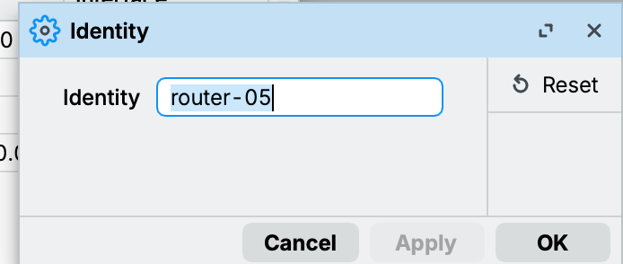
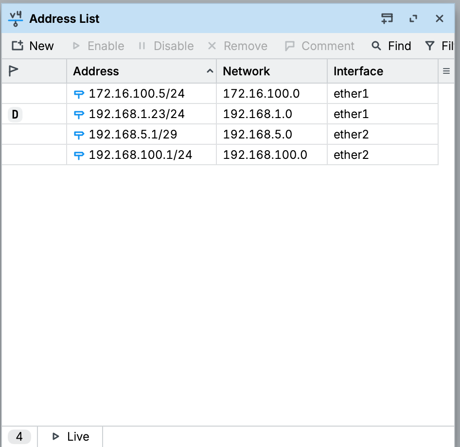
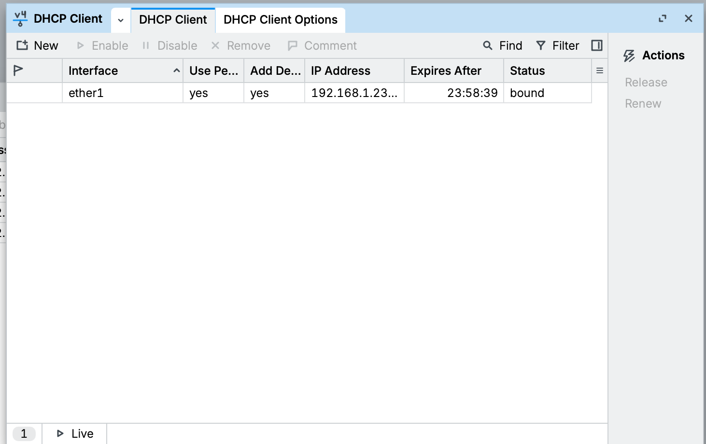
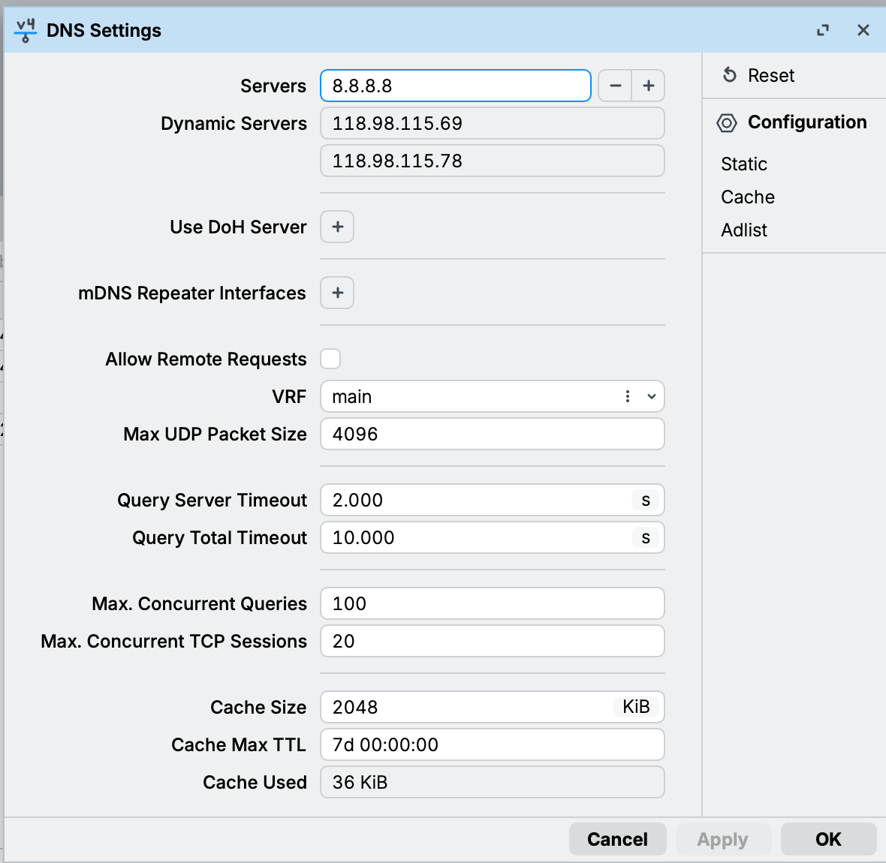
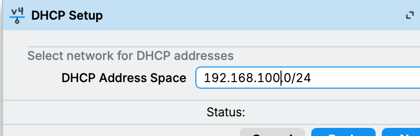
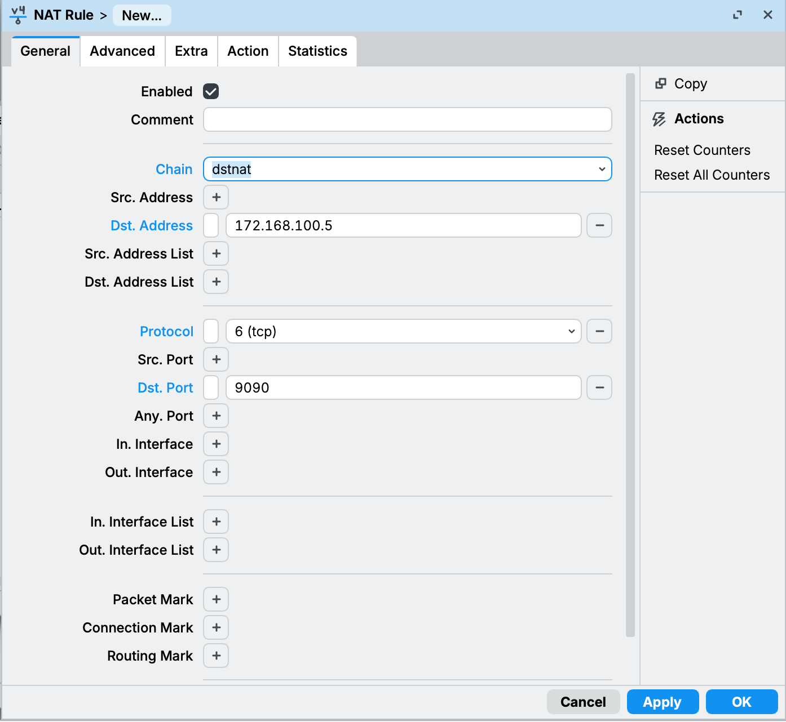
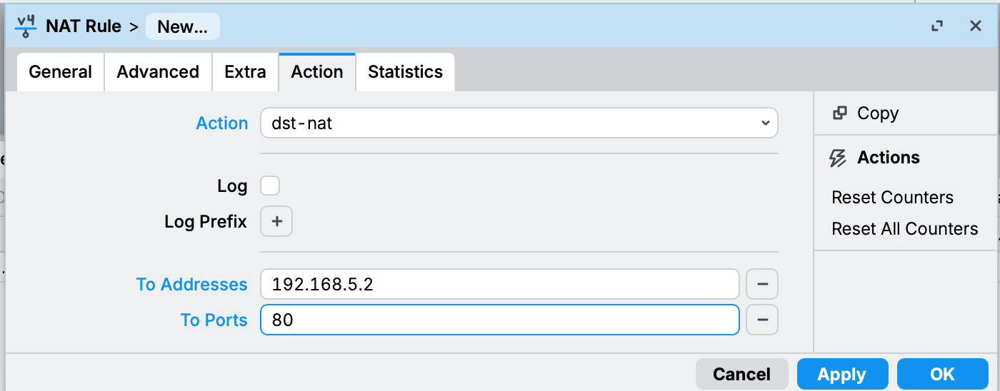
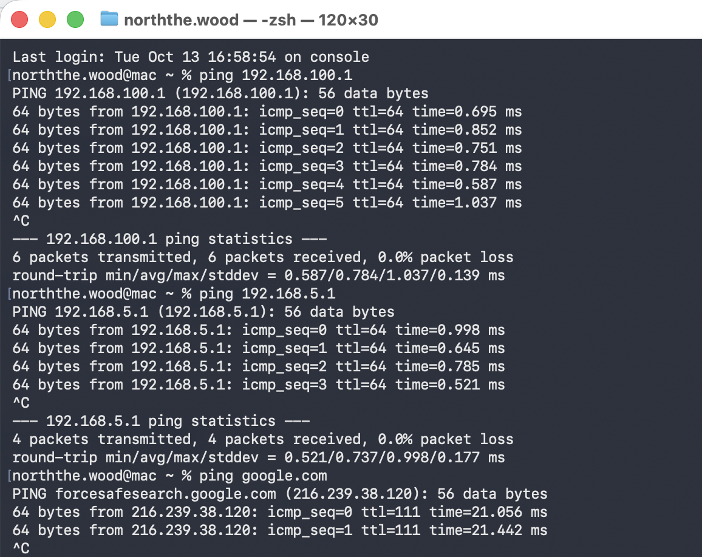

# 01 - Konfigurasi MikroTik

Router: MikroTik hEX, RouterOS 7.16.1. Semua diatur lewat WinBox (GUI), mulai dari reset tanpa default configuration (System > Reset Configuration > No Default Configuration).

## 1. Nama router

System > Identity, diisi `router-05`.

## 2. IP address

IP > Addresses. ether1 menghadap ISP, ether2 ke switch. Di ether2 ada dua jaringan: satu untuk server (Proxmox), satu untuk int-client. Alamat `192.168.1.23` muncul sendiri dari DHCP router rumah (tanda D).

| Address | Interface | Fungsi |
|---|---|---|
| 172.16.100.5/24 | ether1 | IP "ISP" sesuai soal |
| 192.168.5.1/29 | ether2 | Gateway jaringan server |
| 192.168.100.1/24 | ether2 | Gateway int-client |

## 3. Internet dari ISP

IP > DHCP Client, interface `ether1`. Statusnya harus `bound`.

## 4. DNS

IP > DNS, server `8.8.8.8`.

## 5. DHCP server untuk int-client

IP > DHCP Server > DHCP Setup. Karena ether2 punya dua jaringan, address space diisi manual `192.168.100.0/24` supaya yang dibagikan IP untuk int-client.

| Langkah | Isi |
|---|---|
| Interface | ether2 |
| Address space | 192.168.100.0/24 |
| Gateway | 192.168.100.1 |
| Pool | 192.168.100.10 - 192.168.100.50 |
| DNS | 118.98.115.69, 118.98.115.78, 8.8.8.8 |
| Lease time | 30 menit |

## 6. NAT masquerade (internet gateway)

IP > Firewall > NAT. Chain `srcnat`, out interface `ether1`, action `masquerade`. Ini yang bikin semua jaringan di belakang router bisa internetan.

## 7. NAT dst-nat (akses LMS dari luar)

Supaya ext-client bisa buka LMS lewat `172.16.100.5:9090`, request itu diteruskan ke web-05 port 80.

| Field | Isi |
|---|---|
| Chain | dstnat |
| Dst. Address | 172.16.100.5 |
| Protocol | 6 (tcp) |
| Dst. Port | 9090 |
| Action | dst-nat |
| To Addresses | 192.168.5.2 (nanti diganti ke lb-05, 192.168.5.5) |
| To Ports | 80 |

Hasil akhir tabel NAT:

## 8. Tes

Dari laptop yang dicolok ke switch (sebagai int-client), laptop dapat IP dari DHCP lalu dites ping ke gateway int-client, gateway server, dan internet. Semua berhasil.

